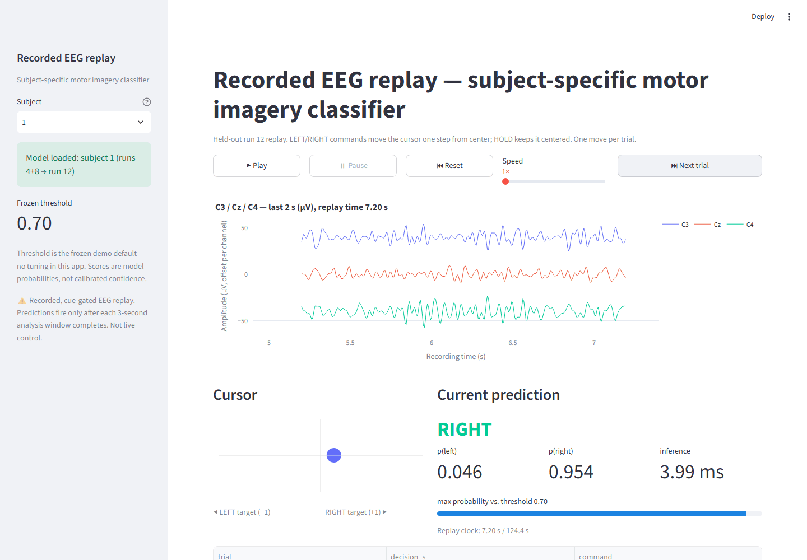

# EEG Motor Imagery Controller

A local, recorded-replay EEG brain–computer interface demonstration: it replays
public motor-imagery EEG recordings, classifies **left vs. right imagined fist
movement** with CSP + LDA, and converts predictions into cursor commands.
An interactive Streamlit demo (`app.py`) walks through the held-out recording
trial by trial with waveforms, a cursor, and live predictions.



> **What this is and is not**
>
> This is a **cue-timed replay of recorded data** — a demonstration of a
> reproducible BCI pipeline, *not* live mind reading, not an asynchronous intent
> detector, not a medical device, and not a validated wheelchair controller.
> Predictions are issued only after each 2-second analysis window completes
> (cue + 3.0 s). The controller moves a simple cursor; it is not an emergency
> stop, and it has no validated "rest" detection.

---

## What works (measured, not aspirational)

- Downloads PhysioNet **EEGMMIDB v1.0.0** runs 4/8/12 via MNE's `eegbci` loader.
- Causal per-run preprocessing under a fixed data contract (below).
- Explicit annotation mapping **T1 → left (0), T2 → right (1)**; T0 rest is
  skipped and never relabeled. MNE-assigned numeric event IDs are never used.
- CSP+LDA fitted **only on development runs (4+8)**; evaluated on held-out
  run 12. Software-verification reruns are not new independent evidence.
  Labels are used for training/evaluation only —
  they never generate or correct commands.
- Honest metrics: all-trial accuracy, confusion matrix, majority baseline,
  coverage, accepted-command accuracy, incorrect-command rate, inference time.
- Synthetic behavior tests plus a separately marked real-data integration test.

### Measured results — subject-specific, held-out run 12, threshold 0.70

15 eligible evaluation trials per subject; 30 training trials (runs 4+8).
No trial was excluded by the quality checks (see
`data/exclusions_subj*.csv`, all empty).

| Subject | Accuracy | Balanced acc. | Majority baseline | Coverage | Accepted acc. | Incorrect issued | Rejected |
|--------:|---------:|--------------:|------------------:|---------:|--------------:|-----------------:|---------:|
| 1 | **0.800** | 0.804 | 0.467 | 0.933 | 0.786 | 3/15 | 1 |
| 2 | **0.733** | 0.723 | 0.533 | 0.933 | 0.786 | 3/15 | 1 |
| 3 | 0.467 | 0.482 | 0.533 | 0.600 | 0.556 | 4/15 | 6 |
| 4 | 0.533 | 0.562 | 0.533 | 0.867 | 0.615 | 5/15 | 2 |
| 5 | 0.600 | 0.598 | 0.533* | 0.733 | 0.545 | 5/15 | 4 |

\* Subject 5's majority baseline was label 1 (right), so its test accuracy is
0.533 with 8/15 right-class trials.

Reading these numbers honestly:

- **Within-subject, held-out-run performance only.** Nothing here measures
  generalization to a new person. Three runs per subject is very limited
  evidence; do not draw sweeping conclusions from 15 test trials.
- Subjects 3–5 sit at or near the majority baseline — the model fails there,
  and the report shows it rather than hiding it.
- `accepted accuracy` is computed **only over issued commands**; `coverage`
  (accepted / eligible) is always reported alongside it. Neither alone is
  adequate: a model could reach 100% accepted accuracy at 5% coverage.
- `inference_ms` now measures actual single-trial model inference (including
  probability mapping), not command selection. Earlier 0.01–0.04 ms claims
  were incorrect and are withdrawn. Current median/p95 values are in the
  metrics JSON. Cue-to-decision delay remains 3.0 seconds.

## Review corrections

The code review corrected inference timing, per-trial cursor resets, excluded
trial audit records, model/config compatibility checks, and exploratory output
isolation. Results were rerun only to verify these fixes; no model parameters
or thresholds were tuned against run 12. An explicit `--threshold` override
different from the model's stored threshold writes `_exploratory` outputs.

Only load joblib artifacts you generated or otherwise trust: joblib loading can
execute code. Metadata validation is a compatibility check, not a security boundary.

Filter startup settling is conservatively set to 1 second. Step-response and
in-band sine fixtures validate this choice. Quality checks reject channel SD
at or below 1e-12 V or absolute bandpassed amplitude above 1e-3 V; these fixed
checks are not clinically validated artifact rejection.

Full per-run metrics: `artifacts/metrics_sub*.json`; per-trial records:
`artifacts/predictions_sub*.csv`.

---

## Setup

Tested with **Python 3.13.14** on Windows (PowerShell). Direct dependencies are
listed in `requirements.txt`; the fully resolved environment is pinned in
`requirements-lock.txt`. Any Python ≥3.12 with current versions of the listed
packages should work, but only the versions in the lock file were verified.

```powershell
git clone <this-repo>
cd eeg-motor-imagery-controller
python -m venv .venv
.\.venv\Scripts\python.exe -m pip install --upgrade pip
.\.venv\Scripts\python.exe -m pip install -e .
.\.venv\Scripts\python.exe -m pip install pytest streamlit
```

Verified on a fresh install (new venv, follow the commands top to bottom):
prepare → train → evaluate for subjects 1–5, then `pytest` (92 passed) and the
app launch below.

## Launch the demo app

```powershell
.\.venv\Scripts\python.exe -m streamlit run app.py
```

- **Sidebar:** subject selection (1–5) with per-subject model + contract
  validation, frozen threshold (0.70), and disclosure notices.
- **Replay area:** C3/Cz/C4 waveforms in µV (only samples with timestamp ≤
  replay time are shown), cursor with LEFT/RIGHT targets, current prediction
  (LEFT/RIGHT/HOLD, p(left), p(right), measured inference time), and command
  history.
- **Controls:** ▶ Play, ⏸ Pause, ⏮ Reset, 1×/2×/4× speed, ⏭ Next trial
  (jumps exactly to the next unprocessed decision time — one command per
  trial, no duplicates).
- **Results tab:** the saved held-out metrics (accuracy, balanced accuracy,
  confusion matrix, coverage, accepted-command accuracy, majority baseline,
  incorrect issued, inference time) plus CSV/JSON downloads. True labels
  appear only here — never in the replay path.

The threshold is fixed at the model's frozen default in the app. Interactive
threshold changes were intentionally omitted from this release; exploratory
threshold evaluation belongs to the offline CLI (`scripts/evaluate.py
--threshold`, which writes separate `_exploratory` files).

## Dataset download

The recordings are **not committed** to this repository (see License and
attribution below); the downloader fetches them from PhysioNet (~37 MB for
5 subjects × 3 runs):

```powershell
.\.venv\Scripts\python.exe scripts/prepare_data.py --subjects 1 2 3 4 5 --config configs/default.json
```

Files land under `data/raw/MNE-eegbci-data/files/eegmmidb/1.0.0/` (MNE's
layout; the resolved path per trial is persisted in `data/trials_subj*.csv`).

## Exact run mapping

| Run | Task | Used as |
|----:|------|---------|
| 4  | Motor **imagery**: left vs. right fist | development training |
| 8  | Motor **imagery**: left vs. right fist | development training |
| 12 | Motor **imagery**: left vs. right fist | **held-out final evaluation** |

Runs 6/10/14 are *hands vs. feet* imagery — the loader **rejects** them for
this task (`tests/test_labels.py`), and they must never be relabeled left/right.
T1 annotations map to left, T2 to right, explicitly, by *description*.

Training/evaluation commands:

```powershell
.\.venv\Scripts\python.exe scripts/train.py --subject 1 --config configs/default.json
.\.venv\Scripts\python.exe scripts/evaluate.py --subject 1 --config configs/default.json
```

Repeat `--subject 2` … `--subject 5`. The subject set (1–5) was fixed in
advance; no subject was selected after seeing results.

---

## Architecture

```
public EDF recordings (PhysioNet EEGMMIDB)
   └─ scripts/prepare_data.py
        └─ src/eeg_controller/data.py        download, EDF read, standardize names,
                                             explicit T1/T2 mapping, trial table + hashes
        └─ src/eeg_controller/preprocess.py  per-run causal filter (SOS, forward-only),
                                             common-average reference, cue-aligned epochs,
                                             quality exclusions with recorded reasons
   └─ scripts/train.py                       CSP+LDA fitted on dev runs (4+8) only
        └─ src/eeg_controller/model.py       sklearn Pipeline, joblib artifact + JSON provenance
   └─ scripts/evaluate.py                    single evaluation on run 12
        └─ src/eeg_controller/evaluate.py    predictions.csv, metrics JSON
        └─ src/eeg_controller/controller.py  probabilities → LEFT/RIGHT/HOLD → cursor
        └─ src/eeg_controller/replay.py      deterministic timing (no early/duplicate moves)
   └─ app.py                                 interactive recorded-replay demo (Streamlit)
        └─ src/eeg_controller/demo.py        pure replay/demo logic (no Streamlit):
                                             event building, live single-trial inference,
                                             display-only µV waveform windows
   └─ scripts/capture_assets.py              screenshot/GIF capture (optional, dev only)
```

Labels feed **evaluation and optional target placement only** — never command
generation. `choose_command()` accepts probabilities and classes; a test
asserts that flipping every true label leaves all commands unchanged.

### Fixed data and preprocessing contract

| Parameter | Value |
|---|---|
| Channels | C3, Cz, C4, FC3, FCz, FC4, CP3, CPz, CP4 (this exact order) |
| Referencing | per-sample mean across those nine channels |
| Filter | Butterworth bandpass 8–30 Hz, 4th order, SOS (`scipy.signal.sosfilt`) |
| Causality | forward-only; state resets per run, persists within a run; never `filtfilt` |
| Trial interval | [1.0, 3.0) s after T1/T2 onset → exactly 320 samples at 160 Hz |
| Baseline correction | none |
| CSP components | 4 (`reg="ledoit_wolf"`, `log=True`, `norm_trace=False`) |
| LDA | `solver="lsqr"`, `shrinkage="auto"` |
| Seed | 42 for any randomized operation |

All parameters live in `configs/default.json` and are validated at load time
(a config requesting hands/feet runs or a non-causal filter is rejected).

---

## Tests

```powershell
.\.venv\Scripts\python.exe -m pytest -q                    # 88 synthetic tests
.\.venv\Scripts\python.exe -m pytest -q -m integration     # real-data + app smoke tests
```

Synthetic tests verify **mechanics** (epoch boundaries, filter causality,
split isolation, controller behavior, replay timing, label isolation,
metric nulls, demo logic), not classification effectiveness. The marked
integration tests verify the contract on real EDF data (channel names/order,
160 Hz, 320-sample epochs, T1/T2 mapping) and smoke-test the Streamlit app
via Streamlit's `AppTest` framework (subject load, Next-trial decisions
without duplicates, subject-switch reset).

In restricted Windows environments where the default pytest temporary
directory is inaccessible, append `--basetemp=.pytest_tmp` to either command.

## Limitations

- **Recorded replay, not live control.** Predictions are timestamp-gated to
  cue-locked windows; there is no asynchronous detection. Predictions are
  computed live at each decision time, but they are fully determined by the
  recording — nothing is sensed in real time.
- **Within-subject only**, three runs per subject, 15 test trials each —
  far too little data for generalization claims.
- **Two classes only** (left/right imagery). Rest (T0) produces no decisions
  by construction; the controller has no rest/stop semantics.
- **Threshold 0.70 is a demo parameter**, not a validated operating point.
  The app does not expose threshold tuning; exploratory thresholds belong to
  the offline CLI only.
- CSP+LDA on 30 training trials is a **baseline**, not a tuned or novel
  method. No deep learning, no subject-to-subject transfer.
- The cursor game is a mechanical demonstration; there is no user study.
- Subjects 3–5 performed at baseline: the pipeline visibly fails for some
  people, as real BCI does.
- App probability scores are model outputs, **not calibrated confidence**.

## License and attribution

- **Code:** MIT.
- **Dataset:** [PhysioNet EEG Motor Movement/Imagery Dataset v1.0.0](https://physionet.org/content/eegmmidb/1.0.0/)
  — recordings are not redistributed here; run the downloader instead. Verify
  the PhysioNet health-sciences data usage terms before any redistribution.
- Recordings were contributed by [BCI2000](https://www.bci2000.org/) with
  funding from NIH/NIBIB (R24EB009353) and the DARPA NES program.

### Credits / references

- Schalk, G., McFarland, D.J., Hinterberger, T., Birbaumer, N., Wolpaw, J.R.
  (2004). *BCI2000: a general-purpose brain-computer interface (BCI) system.*
  IEEE TBME 51(6):1034–1043.
- Goldberger, A.L. et al. (2000). *PhysioBank, PhysioToolkit, and PhysioNet.*
  Circulation 101(23):e215.
- Gramfort, A. et al. MEG & EEG data analysis with MNE-Python. MNE docs:
  [eegbci.load_data](https://mne.tools/stable/generated/mne.datasets.eegbci.load_data.html),
  [CSP decoding example](https://mne.tools/stable/auto_examples/decoding/decoding_csp_eeg.html)
  (task mapping adapted: this project uses left/right imagery, not hands/feet).
- [scikit-learn LDA](https://scikit-learn.org/stable/modules/generated/sklearn.discriminant_analysis.LinearDiscriminantAnalysis.html)

This project is an **integrated application** (reproducible pipeline, replay
logic, evaluation, documentation) — not original CSP/LDA research.
